<div align="center">

# XXD Panel 028｜아이소메트릭 미니 풍경

**사진을 원래 색으로 그린 종이 위 아이소메트릭 미니어처 모형, 작은 건축 디오라마처럼 놓아 둡니다.**

<a href="README.md">简体中文</a> · <a href="README.en.md">English</a> · <a href="README.ja.md">日本語</a> · <strong>한국어</strong> · <a href="README.ar.md">العربية</a>

</div>

<table>
  <tr>
    <td width="50%">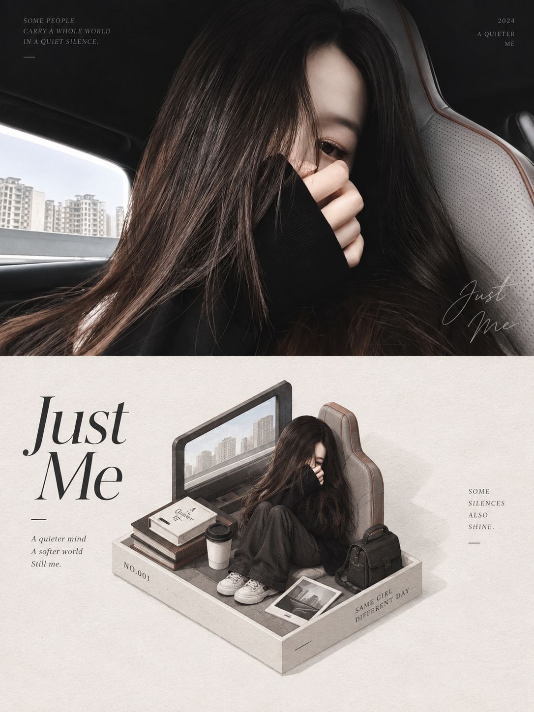</td>
    <td width="50%">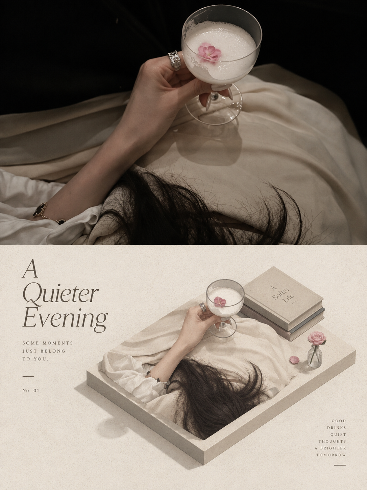</td>
  </tr>
</table>

<p align="center"><sub>위는 원본 사진, 아래는 이 스타일로 다시 그린 모습입니다.</sub></p>

## 무엇인가요

Claude Code, Codex 같은 AI 에이전트용 Skill입니다. 사진 한 장을 주면 Panel 028의 원본 프롬프트대로 완성된 PNG를 그립니다.

- **어떤 그림이 되나요:** 주인공을 잘라 내 작은 종이 조각이나 미니 받침대 위에 올리고, 아이소메트릭 시점, 단순화한 덩어리, 깔끔한 가장자리, 약간의 작은 디테일로 다시 표현하며, 그래도 한눈에 알아볼 수 있습니다. 둘레는 넓은 여백이고, 부피 대비, 가장자리 잘림, 옅은 그림자로 크기감과 약간의 고독감을 주며 보조 요소는 아주 적습니다. 색은 모두 사진에서 가져와 정리하고 맑게 다듬고 부드럽게 한 한정 팔레트로 만들며, 원본의 차갑고 따뜻한 성격을 지키고 상관없는 고정 배색은 넣지 않습니다. 구조는 가는 먹선, 평평한 색면, 옅은 그림자, 종이 결로 나타냅니다. 글자는 짧은 제목과 약간의 번호나 짧은 메모로, 받침대, 수평축, 아이소메트릭 구조를 따라 놓입니다.
- **키워드:** 정투영 아이소메트릭 · 미니어처 받침대 · 한정 팔레트 · 가는 먹선 · 종이 위 일러스트
- **만들 수 있는 것:** 위아래 비교(위 사진, 아래 디자인), 좌우 비교, 디자인만, 또는 휴대폰·태블릿·PC·워치 배경화면 세트. 여러 개를 함께 고를 수 있고 비율과 픽셀도 자유입니다.
- **이런 것은 아닙니다:** 필터도 템플릿도 아닙니다. 매번 사진에서 새로 그리며, 사진 한 장이 하나의 독립된 작업입니다.

## 세 단계로 시작하기

**1. 설치.** Claude Code, Codex 등 Skills를 지원하는 에이전트에서 쓸 수 있습니다:

```bash
npx skills add https://github.com/nevertoday/xxd-panel-028 --skill xxd-panel-028
```

설치 후 에이전트 세션을 다시 시작하세요. 이 저장소를 `git clone`한 뒤 `~/.claude/skills/xxd-panel-028` 또는 `~/.codex/skills/xxd-panel-028`에 링크해도 됩니다.

**2. 에이전트가 이미지를 생성할 수 있는지 확인.** 이 Skill에는 자체 이미지 모델이 없고, 에이전트의 이미지 생성(GPT Image 2 권장)을 사용합니다.

- Codex는 내장 이미지 생성이 켜져 있으면 바로 쓸 수 있습니다.
- Claude Code처럼 내장 이미지 생성이 없는 에이전트는 OpenAI 호환 이미지 API가 필요합니다. 5분 정도면 됩니다: [이미지 생성 설정](#이미지-생성-설정).

잘 모르겠다면 그냥 써 보세요. 생성할 수 없으면 작업을 시작하기 전에 Skill이 멈추고 알려 줍니다.

**3. 사진을 보내고 한 문장으로 말하기:**

> xxd-panel-028으로 이 사진을 3:4 위아래 비교 포스터로 만들고 한국어 제목을 붙여 줘.

요청이 충분하면 바로 생성하고, 빠진 것(레이아웃, 비율, 글자)은 보통 한두 가지만 묻습니다. 결과 PNG는 `~/Desktop/xxd/xxd-panel-028/` 아래 새 폴더에 저장됩니다.

## 잘 맞는 사진

**잘 맞아요**

- 건물과 골목 모퉁이: 카페, 오래된 집, 작은 역, 돌계단
- 경계가 분명한 장면: 바닷가 작은 선착장, 숲속 캠핑장, 옥상 정원, 서재
- 탈것과 큰 물건: 캠핑카, 고깃배

**잘 맞지 않아요**

- 얼굴을 가까이 찍은 인물 사진(미니어처로 만들면 얼굴이 작아지고 표정이 사라집니다)
- 고채도 색 충돌이나 사진과 상관없는 배색을 원하는 경우
- 플라스틱 3D 질감이나 장면을 꽉 채운 결과를 원하는 경우

## 샘플

아래 이미지는 모두 이 Skill이 사진 한 장으로 만든 완성작입니다. 위아래 비교와 좌우 비교는 서로 다른 사진을 썼습니다.

### 위아래 비교: 위 사진, 아래 디자인

<table>
  <tr>
    <td width="50%"></td>
    <td width="50%"></td>
  </tr>
  <tr>
    <td width="50%">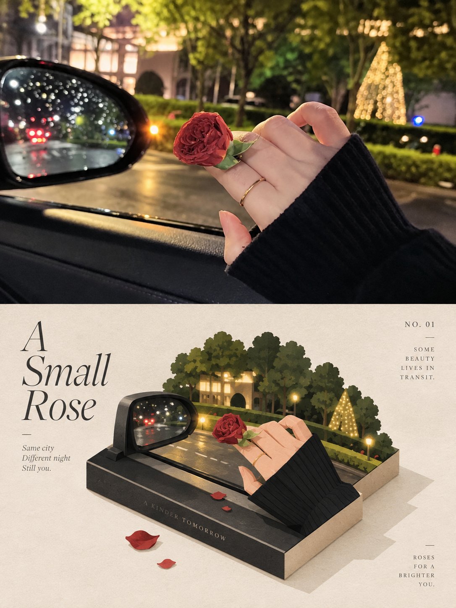</td>
    <td width="50%">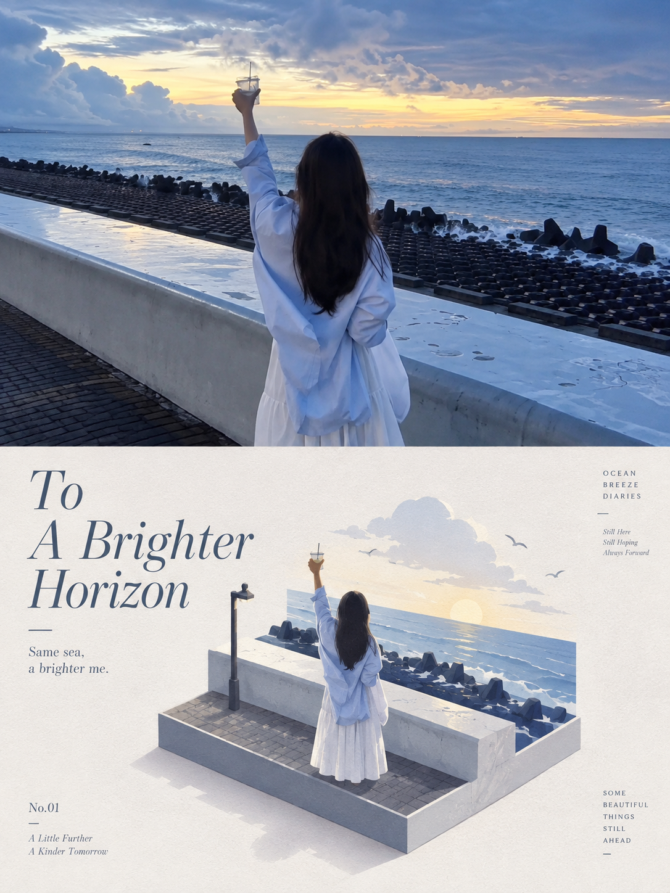</td>
  </tr>
</table>

### 좌우 비교: 왼쪽 사진, 오른쪽 디자인

<table>
  <tr>
    <td width="50%">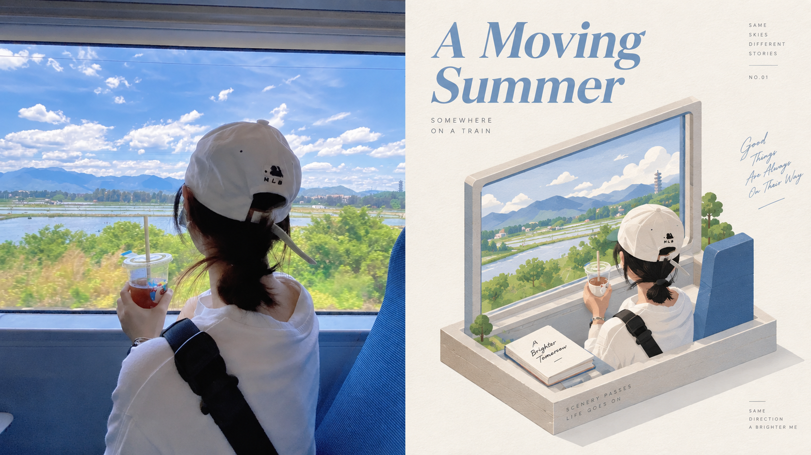</td>
    <td width="50%">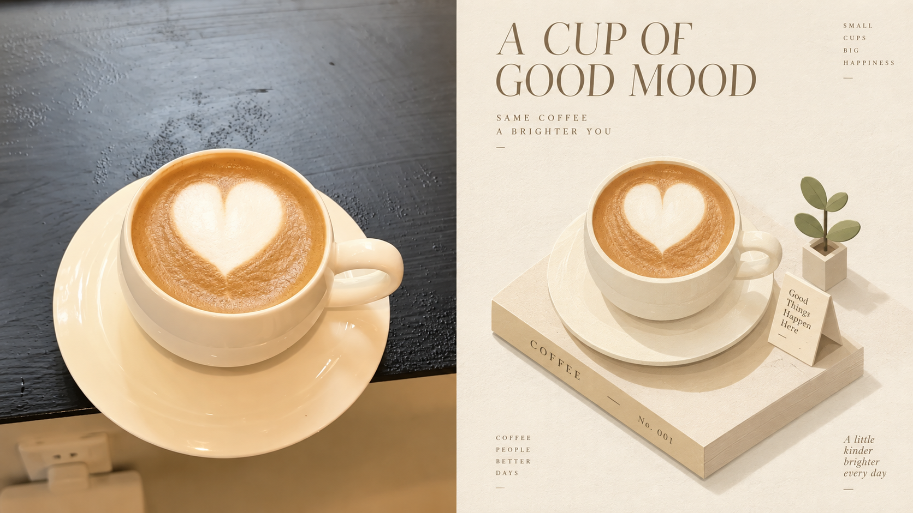</td>
  </tr>
  <tr>
    <td width="50%">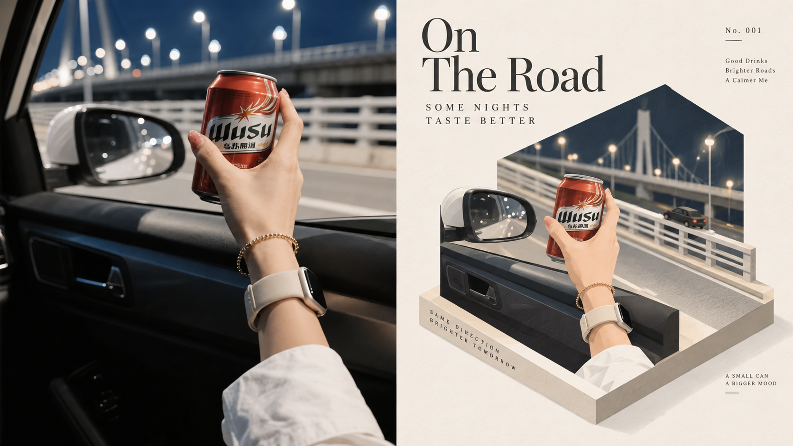</td>
    <td width="50%">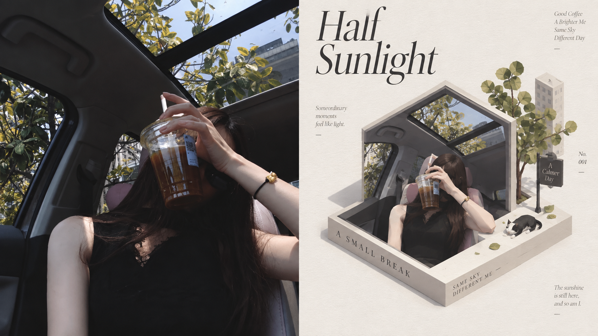</td>
  </tr>
</table>

### 작가의 원본 샘플

이 스타일을 공개할 때 샤오샤오둥이 X에 올린 샘플입니다. 이미지를 누르면 원래 게시물이 열립니다.

<table>
  <tr>
    <td width="50%"><a href="https://x.com/xiaoxiaodong01/status/2090447110168822128">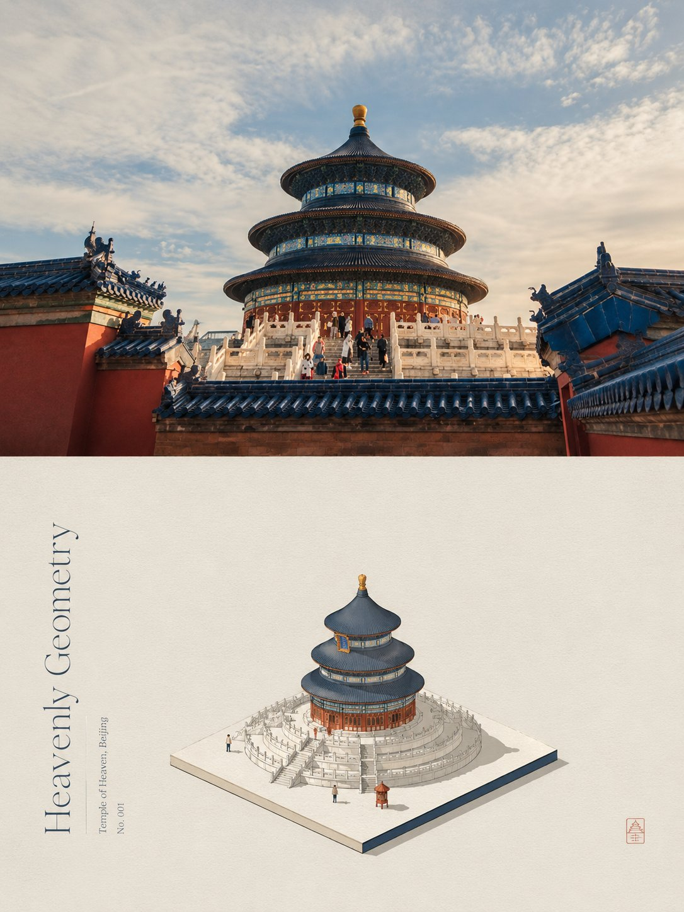</a></td>
    <td width="50%"><a href="https://x.com/xiaoxiaodong01/status/2090447110168822128">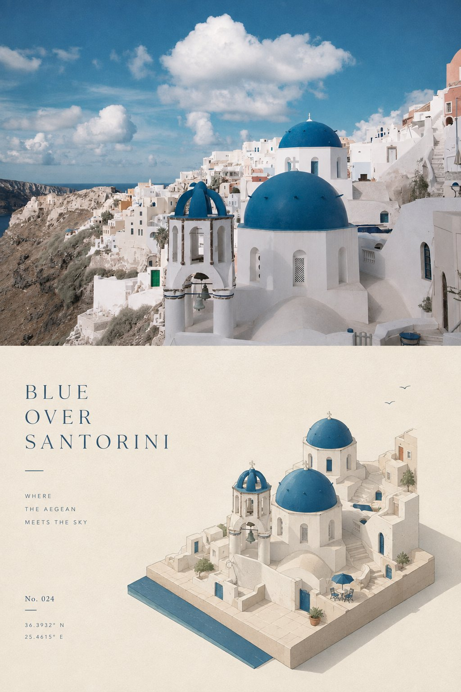</a></td>
  </tr>
  <tr>
    <td width="50%"><a href="https://x.com/xiaoxiaodong01/status/2090447110168822128">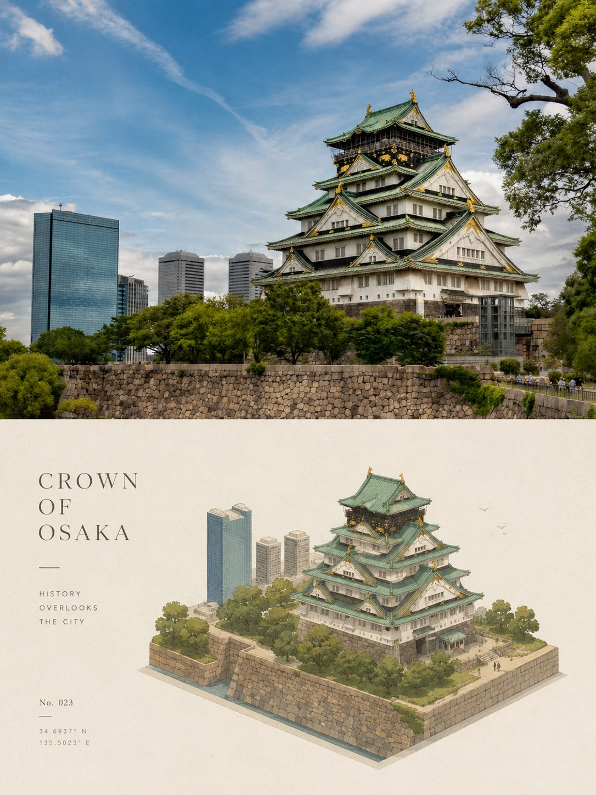</a></td>
    <td width="50%"><a href="https://x.com/xiaoxiaodong01/status/2090447110168822128">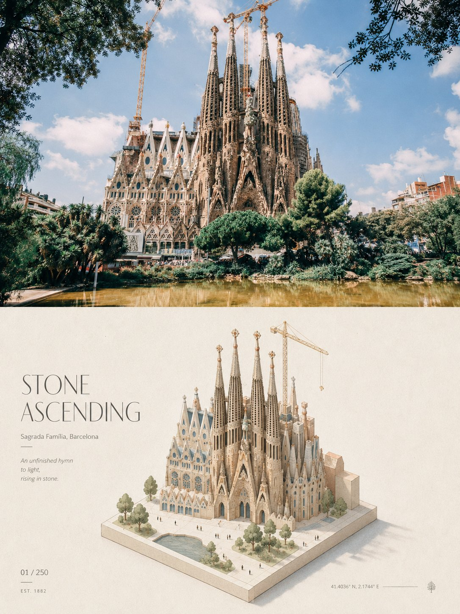</a></td>
  </tr>
</table>

## 이렇게 말하면 됩니다

파라미터를 외울 필요 없이 그대로 말하세요:

| 원하는 것 | 이렇게 말하기 |
|---|---|
| 위아래 비교 | 3:4 위아래 비교로 만들어 줘 |
| 좌우 비교 | 16:9 좌우 비교, 왼쪽에 사진 |
| 디자인만 | 사진 없이 디자인만, 9:16 세로 |
| 배경화면 세트 | 휴대폰, 태블릿, PC, 워치 배경화면을 통일된 세트로 |
| 여러 비율 | 같은 사진으로 1:1, 3:4, 16:9 한 장씩 |
| 내 글자 그대로 | 제목은 「바람이 지나가는 곳」, 한 글자도 바꾸지 마 |
| 글자 없음 | 글자는 하나도 넣지 마 |
| 글자 언어 | 글자는 일본어로 |
| 폴더 전체 | 이 폴더의 사진을 전부 위아래 비교로 |
| 지난번과 같이 | 지난번 설정 그대로 |

명령줄이 편하다면 파라미터가 위와 일대일로 대응합니다:

```text
/xxd-panel-028 photo.jpg --mode top-bottom --size 3:4 --text prompt --locale ko-KR
/xxd-panel-028 photo.jpg --mode design-only --size 9:16 --text none
/xxd-panel-028 ./photos --mode left-right --size 16:9 --text prompt --locale en-US
```

전체 파라미터는 [파라미터 목록](#파라미터-목록)에 있습니다.

## 자주 묻는 질문

**원본 사진이 꼭 들어가나요?** 아니요. "디자인만"이나 배경화면을 고르면 화면 전체가 디자인입니다.

**글자는 누가 쓰나요?** 기본적으로 이미지 모델이 사진을 보고 쓰고, 여러분은 언어만 고릅니다. 직접 쓴 글자를 주면 한 글자도 바꾸지 않고, 글자 없이도 만들 수 있습니다. 사실처럼 보이는 정보(지명, 날짜, 숫자)는 여러분이 준 것이나 사진에 보이는 것만 쓰고 지어내지 않습니다.

**마음에 들지 않으면요?** "한 장 더"라고 하세요. 이전 결과를 고치는 대신 원본 사진에서 다시 그리므로 매번 결과가 다릅니다.

**여러 장을 한꺼번에 하면 섞이지 않나요?** 섞이지 않습니다. 사진마다 따로 생성하고 다른 사진의 색, 글자, 구도를 빌리지 않습니다. 설정은 한 번만 묻습니다.

**제 사진은 어디로 가나요?** 에이전트가 쓰는 이미지 모델로만 갑니다. Skill은 다른 곳에 올리지 않고 접속 주소나 키도 표시하지 않습니다.

**다른 Panel과는 어떤 관계인가요?** XXD Panel은 번호마다 스타일이 하나씩인 독립된 모음입니다. 마음에 드는 것만 설치해도 됩니다. 사진에 맞는 스타일을 AI가 추천하게 하거나 여러 개를 비교하려면 카탈로그 [xxd-panel-all](https://github.com/nevertoday/xxd-panel-all)을 쓰세요.

## 원본 프롬프트

이 스타일은 샤오샤오둥이 쓴 [원본 프롬프트](references/original-prompt/zh-CN.md)(중국어)만으로 정해집니다. Skill은 여러분이 고른 레이아웃, 크기, 글자 설정을 뒤에 덧붙일 뿐, 요약하거나 번역하거나 고쳐 쓰지 않습니다.

참고 번역(읽기용이며 이미지 생성에는 쓰지 않음): [English](references/original-prompt/en.md) · [日本語](references/original-prompt/ja.md) · [한국어](references/original-prompt/ko.md) · [العربية](references/original-prompt/ar.md)

## 이미지 생성 설정

`gpt-image-2`(또는 호환 모델)를 제공하는 OpenAI 호환 API와 그 API 키가 필요합니다. 아래 방법은 별도 설정을 만들어 Codex 자체 설정에는 영향을 주지 않습니다:

```bash
mkdir -p ~/.xxd-imagegen
cat > ~/.xxd-imagegen/config.toml <<'EOF'
model_provider = "image"

[model_providers.image]
base_url = "https://api.openai.com/v1"   # 또는 호환 엔드포인트
env_key = "XXD_IMAGE_API_KEY"
EOF

# ~/.zshrc 또는 ~/.bashrc에 넣어 에이전트도 읽을 수 있게
echo 'export XXD_IMAGEGEN_CODEX_DIR=~/.xxd-imagegen' >> ~/.zshrc
echo 'export XXD_IMAGE_API_KEY=내-키' >> ~/.zshrc
```

터미널과 에이전트를 다시 연 뒤, 이 Skill 폴더에서 한 번 확인하세요:

```bash
python3 scripts/configured_imagegen.py probe
```

`"ok":true`가 나오면 성공입니다. 사용 가능 여부만 보여 주고 주소나 키는 출력하지 않습니다. Codex가 이미 호환 API로 이미지를 만들고 있다면 이 단계는 필요 없습니다.

## 파라미터 목록

| 파라미터 | 값 |
|---|---|
| `--mode` | `top-bottom` 위아래 비교 · `left-right` 좌우 비교 · `design-only` 디자인만 · `wallpaper-pack` 4종 배경화면; 여러 개 선택 가능 |
| `--size` | `auto` 추천 · `source` 사진 비율 · `1:1` `3:4` `4:3` `4:5` `5:4` `2:3` `3:2` `9:16` `16:9` `21:9` `5:7` `7:5` · 정확한 픽셀(예 `2160x3840`); 여러 개 선택 가능 |
| `--text` | `prompt` 사진을 보고 작성 · `exact` 내 글자 그대로(`--copy "…"`와 함께) · `none` 글자 없음 |
| `--locale` | 글자 언어. 예: `zh-CN` `en-US` `ja-JP` `ko-KR` `ar` |
| `--wallpaper` | `linked` 통일된 세트 · `independent` 네 장 각각 독립 |
| `--wallpaper-size` | 기기별 픽셀. 예: `phone=1440x3200,desktop=3840x2160` |
| `--out` | 출력 루트 변경(기본 `~/Desktop/xxd/xxd-panel-028/`) |
| `--prefs` | `last` 지난번 그대로 · `edit` 지난번에서 수정 · `new` 새로 고르기 · `off` 이번엔 기억 안 함 · `clear` 기록 삭제 |

- 값이 모두 있으면 묻지 않고, 빠진 것만 묻습니다. `photo.jpg` 대신 폴더를 주면 일괄 처리합니다.
- 조합은 한 장씩 생성합니다. 모드 2개 × 크기 3개 = 6장이며, 잘라 낸 것이 아니라 캔버스마다 구도를 새로 잡습니다.
- 비교 이미지는 정확히 50:50입니다. 보통 모델은 디자인 쪽만 그리고 스크립트가 원본 사진을 그대로 옆에 붙이므로, 경계는 가운데이고 사진은 바뀌지 않습니다.
- 파일 이름은 `source-001-street-top-bottom-3x4-1152x1536.png` 형식이며 모두 작업 폴더 하나에 평평하게 저장됩니다.
- 레이아웃, 크기, 글자 방식과 언어만 기억하고 사진, 문구, 키는 저장하지 않습니다.

<!-- xxd-readme-ads:start -->
## XXD 소개

XXD는 Xiaoxiaodong 브랜드 이름의 약자입니다. 이 프로젝트는 [@xiaoxiaodong01](https://x.com/xiaoxiaodong01)이 만들고 관리합니다.

## Xiaoxiaodong 멀티플랫폼 멤버십 · CNY 699/년

> **광고 안내:** 아래 QR 코드와 멤버십·유료 서비스 링크는 XXD의 홍보 정보입니다. 스캔이나 구매는 선택 사항이며 오픈 소스 이용에는 영향을 주지 않습니다.

연간 멤버십 하나로 **Knowledge Planet + XXD 회원 프롬프트 라이브러리 + 모든 General Skills 멤버십**을 함께 이용할 수 있습니다. 각각 따로 구매할 필요가 없습니다.

<!-- xxd-panel-command-system:start -->

### Skills가 함께 작동하는 방식

| 등급 | 포함 내용 | 역할 |
|---|---|---|
| **General** | [`xxd-panel-all`](https://github.com/xiaoxiaodong-ai/xxd-panel-all) | 사용 가능한 번호형 Skills를 찾고, 이미지·주제·용도에 맞춰 추천하며, 여러 스타일과 일괄 작업을 정리합니다. |
| **Soldier** | `xxd-panel-NNN` | 각 번호가 고유한 원본 프롬프트와 미학에 따라 General이 배정한 구체적인 작업을 완성합니다. |

<!-- xxd-panel-command-system:end -->

### 회원 혜택

1. **WeChat 일대일 AI 학습·프로젝트 상담**
   아래 QR 코드로 Xiaoxiaodong의 WeChat을 추가해 AI 학습, 도구, 실제 프로젝트를 일대일로 상담하고 실용적인 답변과 안내를 받을 수 있습니다. 대표적인 질문은 회원 자료로 정리됩니다.
2. **계속 업데이트되는 회원 프롬프트 라이브러리**
   [XXD 회원 프롬프트 라이브러리](https://vip.xiaoxiaodong.ai/)에는 현재 약 3만 2천 개의 프롬프트가 있으며, 10만 개 이상을 목표로 계속 확장합니다.
3. **모든 General Skills와 사용 지원**
   하나의 멤버십으로 모든 General Skills를 이용하고, 사용 중 도움이 필요할 때 안내와 Q&A를 받을 수 있습니다.
4. **필요성이 높은 요청을 우선 검토**
   회원이 제안한 수요가 높고 꼭 필요한 프롬프트와 Skills는 우선 검토하고 개발합니다.

### 가입 방법

- [회원 웹사이트에서 직접 가입](https://vip.xiaoxiaodong.ai/)할 수 있습니다.
- 또는 아래 QR 코드로 Xiaoxiaodong의 WeChat을 추가해 일대일 가입 지원을 받을 수 있습니다.

<p align="center"><a href="https://xiaoxiaodong.pages.dev/assets/wechat-qr.png"></a></p>
<!-- xxd-readme-ads:end -->

## 라이선스

이 프로젝트(Skill, 프롬프트, 스크립트, 문서 및 함께 제공되는 샘플 포함)는 **PolyForm Noncommercial License 1.0.0**에 따라 제공됩니다. 전체 법적 전문은 [LICENSE](LICENSE), 공식 페이지는 <https://polyformproject.org/licenses/noncommercial/1.0.0>에서 확인할 수 있습니다.

쉽게 말하면:

- 개인 학습·연구·실험·테스트·취미·비공개 오락에 사용할 수 있습니다. 자선단체, 교육기관, 공공 연구·안전·보건 기관, 환경보호 단체와 정부기관도 사용할 수 있습니다.
- **비상업적 목적**이라면 사용, 복사, 수정, 2차 저작물 작성, 공유가 가능합니다. 공유할 때는 이 라이선스(또는 위 URL)와 저작자가 제공한 모든 `Required Notice:` 문구를 함께 제공해야 합니다.
- 상업 제품·서비스, 유료 납품, 접근권·라이선스 판매, 상업적 적용이 예상되는 사용은 허용되지 않습니다. 상업적으로 사용하려면 저작권자에게 별도의 서면 허가를 받으세요.
- 명시된 저작권과 제한적인 특허권만 허여됩니다. 상표·브랜드명 등 명시되지 않은 권리는 부여되지 않으며, 라이선스를 재허여하거나 양도할 수 없습니다.
- 위반 서면 통지를 받으면 32일 안에 완전히 준수하고 현실적인 시정 조치를 해야 하며, 그렇지 않으면 라이선스가 종료됩니다. 특허 침해를 주장하는 서면 청구를 하면 특허 라이선스도 즉시 종료됩니다.
- 프로젝트는 **있는 그대로** 제공되며 법이 허용하는 범위에서 보증하지 않습니다. 사용과 결과에 따른 위험은 사용자에게 있습니다.
